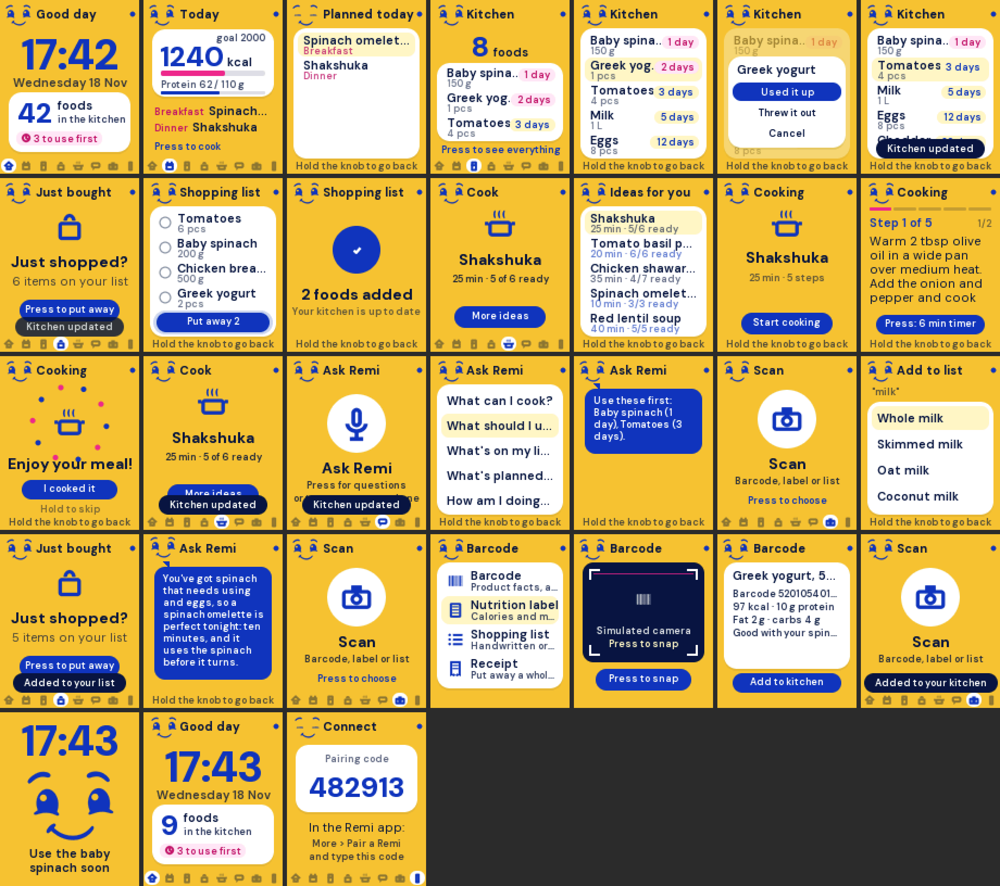

# Remi hardware: the kitchen device

Remi on your counter: a 1.8" screen, one knob and a speaker, driven by an ESP32. It talks to the Remi API in [`backend/`](../backend). It shows the time, what's in your kitchen and what to use first. It puts away your groceries, walks you through recipes with timers, and speaks in Remi's own voice. It reads barcodes, nutrition labels, shopping lists and receipts from a photo, answers questions with Claude, and pairs with the Remi app using a 6-digit code. A microphone for talking to Remi is planned.

- **3D build guide and live simulator:** [`sim/`](sim). See [how to run it](sim/README.md). It shows today's ESP32-CAM bench build, the full wired build, an exploded enclosure and the finished Remi. The 3D screen runs the **real firmware UI and sounds**, compiled to WebAssembly, and you can turn the 3D knob.
- **Preview video with sound:** [`preview/remi-device-preview.mp4`](preview/remi-device-preview.mp4) · screens: [`preview/screens.png`](preview/screens.png)
- **Firmware:** [`firmware/Remi_Device/`](firmware/Remi_Device)



## What it does

**Boot (about 6 s, with music).**

| Time | What you see | What you hear |
|---|---|---|
| 0–1 s | Remi flies in from far away, banking as he comes | A rising whoosh, and a marimba arpeggio that arrives with him |
| 1.05 s | He lands with a little squash | A soft boing on a C-major chord |
| 1.25–2.45 s | He waves three times and blinks, and four foods pop out around him | "Hi!" in his voice, a melody, and a pop for each food |
| 2.15–3.65 s | The logo writes itself (1.5 s, down from 3.6 s) | A pen scribble, then a chime on the final chord |
| 3.6 s | "Cooking made fun" appears | — |
| 4.05 s onward | He flies at you, the camera dives into his face, and the face docks as a blinking avatar while Home fades in | A whoosh, a bloop, and a sparkle |

Press the knob to skip the boot; that also cuts the music.

**Colour.** The whole boot is rendered from Remi's original vectors (`assets/vectors`), so lines stay sharp. The device background is **Remi gold `#F2C230`** rather than the app's lemon `#F8E45C`, which washes out to near-white on the TN-type TFT. To compare shades on your own screen, send `c` in the Serial Monitor: it shows six swatches.

Eight pages, left to right, shown as an icon rail along the bottom of the screen:

| Page | Shows | Press | Inside |
|---|---|---|---|
| **Home** | Greeting, time, date, foods in the kitchen, how many to use first | Sync now | — |
| **Today** | Calories and protein so far against your goal, plus today's planned meals | Cook a planned meal | Opens that recipe straight into cook mode |
| **Kitchen** | Your foods, soonest expiry first, with days left | See everything | Pick a food, then **Used it up** (`consumeStock`) or **Threw it out** (`discardStock`) |
| **Just bought** | Items on the active shopping list | Open the list | Tick what you bought, then **Put away** (`addStock` and marked bought). Typing "milk" on the phone remote searches the catalogue; you pick the match with the knob and it's added to the list |
| **Cook** | Best recipe for what you have | Recipe ideas | Steps with timers. At the end, **I cooked it** logs the meal, which deducts the ingredients from the kitchen (`logMeal`) |
| **Ask Remi** | — | Questions | What can I cook? What should I use first? What's on my list? What's planned today? How am I doing today? Answers show at once from your kitchen data; typed questions from the phone go to Claude, with your kitchen as context, and the reply replaces the local answer |
| **Scan** | Barcode, Label, List, Receipt | Pick what you're scanning | Camera viewfinder (ESP32-CAM) or a photo from the phone remote. Claude reads it; Remi shows what it found, and one press puts the foods in the kitchen (`addStock`) or on the shopping list (`addToShoppingList`) |
| **Connect** | QR code for the phone remote (or for joining the setup Wi-Fi), or the pairing code on first run | — | — |

The knob: **turn** = next or previous, **press** = select, **hold** = back. Every action has a sound, and Remi talks in a synthesized robot voice. The look follows the app's "Sip Happy" design (lemon, cobalt, pink and DM Sans; see [`DESIGN.md`](../DESIGN.md)).

**Left alone, it becomes a fridge clock.** After 45 seconds without input, Remi switches to ambient mode: a big clock, Remi's face with eyes that wander and blink, and one rotating line about your kitchen ("2 foods to use first", "Tonight: pasta"). From 22:00 to 06:00 it turns night navy and Remi sleeps. Any turn or press wakes it.

### Design audit (November 2026)

What changed, and why, for a 1.8" TN panel seen from across the kitchen:
- **Navigation you can see.** The old dots became an icon rail with a sliding white pill, so you always know where you are and how far the next page is. The first three times you go into a page, Remi reminds you that holding the knob goes back.
- **Fewer, bigger things.** Small uppercase labels ("COOK NOW", "PLANNED") are gone; each page leads with one large figure or title, readable at fridge distance. Text fits its box or is shortened; nothing overflows.
- **The panel's strengths.** Saturated cobalt, gold and pink on flat fills, which TN panels show well; no thin greys or gradients, which they wash out. Gold `#F2C230` instead of lemon, for the same reason.
- **Remi is alive.** His eyes follow the knob and wander when idle; ambient mode makes the device worth glancing at when you're not using it.
- **Failure is calm.** Without a network the local answers, cached kitchen and sounds still work, and every failed action says what happened in one line.

### Control it from your phone or Mac (no encoder needed)

The device serves its own remote:
1. Open the **Connect** page and scan the QR code, or browse to `http://<device-ip>` (`http://remi.local` also works on Macs and iPhones).
2. You get a **touch knob**: drag it around to turn (20 clicks per turn, like the KY-040), tap to press, hold half a second to go back. On a Mac, use the arrow keys, Space and Esc.
3. The same page has text boxes for **"Add to shopping list"** and **"Ask Remi"**, and four **Scan with your phone** buttons (Barcode, Label, List, Receipt). Each opens the phone camera; the photo is shrunk to 1024 px on the phone, sent to Remi (`POST /photo?mode=0..3`), and Remi jumps to the Scan page while it's read.

These are the same four events the rotary encoder sends, so everything you test now behaves the same once the knob is wired. The Serial Monitor keys still work too: `a`/`d`/`s`/`b`, `c` for the colour test, `t` for the test tone.

**First-time setup from the phone:**
1. With no Wi-Fi saved, Remi starts its own network, **Remi-Setup** (password `cookwithremi`). The Connect page shows a QR code that joins it.
2. Open `http://192.168.4.1/setup` and enter your Wi-Fi, the Remi API address (`http://<mac-ip>:3000/graphql`), your Remi email and password, and your time zone.
3. Remi restarts and joins your Wi-Fi. It signs in once, then **deletes the password** and keeps only a rotating refresh token.

`secrets.h` is now optional: it only supplies first-boot defaults.

**Pair with the Remi app instead of typing a password.** Leave the email and password empty on the setup page. Remi asks the API for a pairing code (`startDevicePairing`) and shows it on the Connect page. In the app, open **More > Pair a Remi device**, type the 6 digits, and the app calls `pairDevice` for your active household. Remi polls `claimDevicePairing` every 3 seconds, receives its own refresh token and household, saves them, and syncs. Codes last 10 minutes. The device's session shows up among your account sessions as "Remi device: Remi kitchen".

### SD card?

**Not needed.** Everything lives in flash (boot animation, fonts, settings) or comes from the API. On the ESP32-CAM, the SD slot shares pins with the screen (IO2, IO13, IO14, IO15), so a card can't be used there anyway.

### Scan and AI replies

The ESP32 can't read text itself, so it sends the photo to the backend, which asks Claude (`claude-opus-5-5`, structured output) to read it:

| Mode | Reads | Then |
|---|---|---|
| Barcode | The number, matched to a product in the catalogue | Add it to the kitchen |
| Label | Name and nutrition facts per serving | Shows the facts; add it to the kitchen |
| List | A handwritten or printed shopping list | Add every matched food to the shopping list |
| Receipt | The food lines on a grocery receipt, matched with `matchReceiptItems`' matcher | Put them all away |

Where photos come from:
- **ESP32-CAM:** the OV2640 camera. The Scan viewfinder shows a live 160×120 preview on the TFT; press to take an 800×600 JPEG. The camera's clock is IO0, which the CAM speaker build uses for DIN, so audio pauses while the camera is on and comes back a second after you leave the viewfinder.
- **Any board:** the phone remote's Scan buttons. On the DevKit (no camera), the viewfinder says to use the phone.

Device endpoints (REST, next to `/graphql`, same Bearer token and `x-household-id` header):
- `POST /device/ask` with `{"question": "..."}` returns `{"reply": "..."}` (at most 280 characters, ASCII for the device fonts).
- `POST /device/scan?mode=barcode|label|list|receipt` with a JPEG or PNG body (up to 6 MB) returns `{title, lines[], action: "kitchen"|"list"|"none", items[{foodId, name, amount, unit}]}`.

Both are limited to 40 calls per 10 minutes per household. The server needs `ANTHROPIC_API_KEY` in `backend/.env`; without it these return 503 and the device keeps its local answers.

## Live preview while designing (like the iOS Simulator)

Change the UI on the Mac, see it instantly, and only flash the device once a design is approved:

```bash
python3 hardware/sim/dev_server.py
```

Then open **http://localhost:8770/preview.html** (or start `remi-live-preview` in Claude's browser pane).

What the preview does:
- **Real firmware:** it runs the actual device code (`ui.cpp`, `gfx.cpp`, `synth.cpp`) compiled to WebAssembly, pixel-exact at 2×, 3× or 4×, with Remi's sounds.
- **Rebuilds on save:** every time a firmware file is saved, the server rebuilds in about 1.5 s and the page swaps in the new build without a refresh.
- **Keeps your place:** your knob inputs are replayed after each reload, so you stay on the screen you were looking at.
- **Shows errors:** if a build fails, the compiler error appears on the page and the last good build keeps running.
- **Regenerates assets:** changing `tools/build_assets.py` or `assets/` regenerates the boot animation, fonts and icons first. This needs Pillow, numpy and Chrome; set `PY` to a Python that has Pillow.
- **Same controls as the device:** the touch knob, the arrow keys, Space and Esc, plus the phone-remote boxes (Add to list and Ask Remi). There's also a screenshot button and a skip-boot toggle.
- **Sample data:** kitchen data comes from `preview/sample_backend.h`. Edit it to try other states, such as an empty kitchen or a long list.

When a design is approved, flash it (ESP32-CAM shown; use `esp32:esp32:esp32:PartitionScheme=huge_app` for the DevKit):

```bash
arduino-cli compile --upload -p /dev/cu.usbserial-XXXX --fqbn esp32:esp32:esp32cam --build-property "compiler.cpp.extra_flags=-DREMI_BOARD=2" hardware/firmware/Remi_Device
```

Toolchain: [wasi-sdk](https://github.com/WebAssembly/wasi-sdk/releases), looked for in `~/.local/share/wasi-sdk-34` (override with `WASI_SDK`).

## Parts list

| # | Part | Key specs | Notes |
|---|---|---|---|
| 1 | **ESP32 DevKit V1 (30-pin)**, ESP32-WROOM-32 | Dual-core 240 MHz, 520 KB SRAM, 4 MB flash, Wi-Fi, 3.3 V logic | Use a WROOM-32 without PSRAM: GPIO16/17 stay free |
| 2 | **ESP32 expansion board (30-pin)** | Screw terminal per pin, 5–12 V DC jack, 3.3 V/5 V rails | Solid wiring instead of loose jumpers |
| 3 | **1.8" TFT, ST7735S, 128×160 (red V1.1 board)** | SPI, 16-bit colour, 34 × 56.4 mm board, 28 × 35 mm active area, onboard AMS1117 | microSD slot on the back is unused |
| 4 | **KY-040 rotary encoder** | 20 clicks per turn, quadrature plus push switch, 10 kΩ pull-ups on CLK/DT | Power it from 3.3 V |
| 5 | **MAX98357A I2S amp** | Class-D, 3.2 W into 4 Ω at 5 V, 9 dB default gain | Takes digital audio directly, no DAC needed |
| 6 | **Speaker 40 mm, 4–8 Ω, 3 W** | 40 × 40 × 25 mm | Fires through the back grille |
| 7 | *INMP441 I2S microphone* | 24-bit, 61 dB SNR, omnidirectional, bottom port | *Planned* |
| 8 | 5 V 2 A supply (USB charger or DC jack) | — | The amp's peaks need more than a laptop USB port |
| 9 | Knob, M7 nut, standoffs, wire | — | — |
| — | *Today's bench:* ESP32-CAM (AI Thinker) and ESP32-CAM-MB | — | Screen-only build, see below |

## Wiring (full build)

| Part pin | → | DevKit | Wire colour in the simulator |
|---|---|---|---|
| TFT VCC | → | **VIN (5 V)**, through the TFT's onboard regulator. Use 3V3 only if J1 is bridged | red |
| TFT GND | → | GND | black |
| TFT CS | → | GPIO5 | blue |
| TFT RESET | → | 3V3 | orange |
| TFT A0 / DC | → | GPIO4 | purple |
| TFT SDA (MOSI) | → | GPIO23 | green |
| TFT SCK | → | GPIO18 | yellow |
| TFT LED | → | 3V3 | orange |
| KY-040 + | → | **3V3**, never 5 V: its pull-ups would put 5 V on the ESP32 pins | orange |
| KY-040 GND | → | GND | black |
| KY-040 CLK | → | GPIO32 | white |
| KY-040 DT | → | GPIO33 | grey |
| KY-040 SW | → | GPIO25 (internal pull-up enabled) | brown |
| MAX98357A Vin | → | VIN (5 V) | red |
| MAX98357A GND | → | GND | black |
| MAX98357A BCLK | → | GPIO26 | pink |
| MAX98357A LRC | → | GPIO27 | cyan |
| MAX98357A DIN | → | GPIO22 | lime |
| MAX98357A GAIN, SD | → | Unconnected: 9 dB gain, mono (L+R)/2 | — |
| Speaker + / − | → | Amp + / − outputs only. **Never GND** | — |
| *INMP441 VDD / GND / L/R* | → | *3V3 / GND / GND* | — |
| *INMP441 SCK / WS* | → | *GPIO26 / GPIO27, shared with the amp (full-duplex I2S)* | — |
| *INMP441 SD* | → | *GPIO35 (input-only, fine for data in)* | teal |

**Why these pins:**
- None are flash/PSRAM pins (6–11, 16–17).
- None are strapping pins that a part would hold the wrong way at reset. GPIO5 (TFT CS) idles high, which is what it needs.
- The encoder is on interrupt-capable GPIOs. The mic data line uses an input-only pin.

**Power budget at 5 V, approximate:**

| Load | Current |
|---|---|
| ESP32 with Wi-Fi | 80–120 mA average, 240 mA peaks |
| TFT with backlight | about 40 mA |
| Encoder and mic | a few mA |
| Amp at full volume | up to about 600 mA peak into 4 Ω (around 300 mA into 8 Ω) |

Total peaks can exceed what a computer's USB port supplies, so use a 2 A supply. The firmware's `SPEAKER_VOLUME` (0.6) leaves headroom.

## Firmware

| File | What it does |
|---|---|
| `Remi_Device.ino` | Hardware glue: ST7735 over SPI at 16 MHz, interrupt-driven encoder, I2S audio task, 30 fps loop |
| `ui.cpp` | Boot intro and all pages, transitions, cooking timer |
| `gfx.cpp` | 128×160 RGB565 framebuffer, anti-aliased DM Sans text, shapes, masks |
| `synth.cpp` | 22 kHz procedural synth: UI sounds and Remi's voice |
| `backend.cpp` | Wi-Fi, NTP clock and the Remi GraphQL API on its own FreeRTOS task |
| `remote.cpp` | Phone/Mac remote (touch knob, add-to-list and ask boxes) and the Wi-Fi/account setup page, served on port 80 |
| `qrcode.c` | QR code generator for the Connect page (Richard Moore, MIT, vendored) |
| `config.h` | Board and pins (`REMI_DEVKIT` or `REMI_ESP32_CAM`) |
| `secrets.example.h` | Optional: copy to `secrets.h` (never committed) for first-boot defaults; otherwise use the setup page |
| Generated | `boot_frames.h` (the boot: 180 frames with shared palette and skip-RLE, plus sound cues) and `ui_assets.h` |

**Build:**
1. Choose ESP32 core 3.x, board **ESP32 Dev Module** (or AI Thinker ESP32-CAM), Partition Scheme **Huge APP (3MB No OTA)**.
2. Install the libraries: Adafruit ST7735 and ST7789, Adafruit GFX and ArduinoJson 7 (the QR code generator is included).
3. Compile and upload:
   ```bash
   arduino-cli compile --upload -p <port> --fqbn esp32:esp32:esp32:PartitionScheme=huge_app hardware/firmware/Remi_Device
   ```

**Backend:** run the API on the same Wi-Fi (`backend/`, see [`docs/phone-testing.md`](../docs/phone-testing.md)), and put `http://<mac-ip>:3000/graphql` in `secrets.h`. The device signs in once, then keeps only a rotating refresh token in flash. All operations are in `queries.h`. Validate them against the schema with:
```bash
node hardware/tools/check_queries.mjs backend
```

| Feature | API |
|---|---|
| Sign in | `login`, then `refreshAccessToken` (saved immediately after each rotation) |
| Household and name | `me`, `myHouseholds`, sent as `x-household-id` |
| Kitchen count and "use first" | `inventory` (pages of 50) |
| Just bought | `shoppingLists`, then `addStock` (idempotency key `remi-device-<itemId>`) and `updateShoppingListItem(PURCHASED)` |
| Cook | `recipeSuggestions`, then `recipe { steps }` |

### Today's ESP32-CAM build

The CAM keeps its current TFT wiring: SCK IO14, MOSI IO13, CS IO15, DC IO2, VCC 5 V, RESET and LED to 3.3 V. It can also drive the **amp and speaker**:

| MAX98357A | → | ESP32-CAM |
|---|---|---|
| BCLK | → | U0T (GPIO1). Serial logs move to the onboard red LED (GPIO33); keyboard input on U0R still works |
| LRC | → | IO4. This pin also drives the flash LED, which flickers while sound plays, so tape over it. I2S stops between sounds, so the LED stays dark otherwise |
| DIN | → | IO0, the upload pin. It's free once the board has booted, so keep the IO0→GND jumper only for uploads. IO12 put out no signal on the bench board, so it isn't used |
| Vin, GND | → | 5V, GND. Volume is limited to 0.4 because USB through the MB sags on loud peaks; a 470 µF capacitor across 5V and GND at the amp helps |
| Speaker + / − | → | Amp + / − only |

On the CAM:
- **The knob and the microphone still need the DevKit.** IO16 is the PSRAM select line, so toggling it can crash the board. IO12 is a boot pin, which the encoder's pull-ups would upset, and IO0 now carries audio.
- **Build:** add `#define REMI_BOARD REMI_ESP32_CAM` at the top of `config.h`.
- **Navigate:** from the Serial Monitor at 115200, `a`/`d` = left/right, `s` = press, `b` = hold, `c` = colour test.
- **Upload:** IO0→GND jumper, TFT A0 unplugged, then RESET. The amp can stay connected.

## Talk to Remi (voice planned; typed questions work now)

1. **Mic:** INMP441 on the shared I2S clocks, data on GPIO35, 16 kHz mono.
2. **Push to talk:** hold the knob on the Talk page. Remi shows a listening face and a level meter.
3. **Backend:** a new `POST /voice/turn` endpoint does speech to text, then reuses `POST /device/ask`'s household context and Claude call, using tools mapped to existing operations: `addToShoppingList`, `addStock`, `consumeStock`, `recipeSuggestions` and starting a recipe on the device. It returns reply text plus device actions.
4. **Reply:** shown in Remi's speech bubble and voiced. Start with the babble voice; real text-to-speech can stream back as 16 kHz PCM through the same amp.
5. **Wake word later:** ESP-SR WakeNet needs an ESP32-S3.

## Simulation and tools

| What | Tool | Why |
|---|---|---|
| 3D build guide | [three.js](https://github.com/mrdoob/three.js) (MIT) | Runs in any browser, no install |
| Exact part models | [Adafruit_CAD_Parts](https://github.com/adafruit/Adafruit_CAD_Parts) (MIT): MAX98357A (3006), 40 mm speaker (3968) | Manufacturer CAD, converted from STEP to GLB with [occt-import-js](https://github.com/kovacsv/occt-import-js) (Open CASCADE) by `sim/step_to_glb.mjs` |
| Other parts | Modelled from datasheet dimensions in `sim/sim.js` | DevKit, expansion board, TFT, KY-040, INMP441, ESP32-CAM and MB have no openly licensed CAD files |
| Live firmware | [wasi-sdk](https://github.com/WebAssembly/wasi-sdk) builds `ui.cpp`, `gfx.cpp` and `synth.cpp` into `sim/remi.wasm` (`sim/build_wasm.sh`) | The 3D screen and speaker run the same code as the ESP32 |
| Preview video | `preview/render.sh` (host C++ build plus ffmpeg) | Frame-exact renders with the synth audio |
| Other options considered | [Wokwi](https://wokwi.com) | Runs ESP32 code and has a KY-040 part, but has no ST7735 and no I2S audio, so it can't run this firmware as built |

Run the simulator locally (it loads three.js from a CDN):
```bash
python3 -m http.server 8765 --directory hardware/sim
```
Then open http://localhost:8765. The views have bookmarkable links: `#today`, `#bench`, `#exploded`, `#product`.

Rebuild the generated pieces:
```bash
python3 hardware/tools/build_assets.py   # boot frames, fonts, icons (needs Pillow, numpy, Google Chrome)
```
```bash
WASI_SDK=/path/to/wasi-sdk hardware/sim/build_wasm.sh
```
```bash
PY=python3 hardware/preview/render.sh    # needs Pillow and imageio-ffmpeg
```

## Status

- **Verified:**
  - The firmware compiles for ESP32 Dev Module (63% of a 3 MB app partition) and ESP32-CAM with the camera (66%), on core 3.3.13.
  - The screen-only build runs on the ESP32-CAM, and its pages work from the Serial Monitor.
  - All GraphQL operations validate against `backend/schema.graphql`.
  - The WebAssembly build renders the same screens as the device code.
- **Not yet verified:**
  - The DevKit build with the knob and speaker on real hardware.
  - Sync, scan, AI replies and pairing against a running API (the backend's device module passes its unit tests and typecheck).
  - The camera preview and capture on the CAM, and audio coming back after the camera turns off.
  - The enclosure is a concept model; dimensions are for planning, not a printable CAD file.
